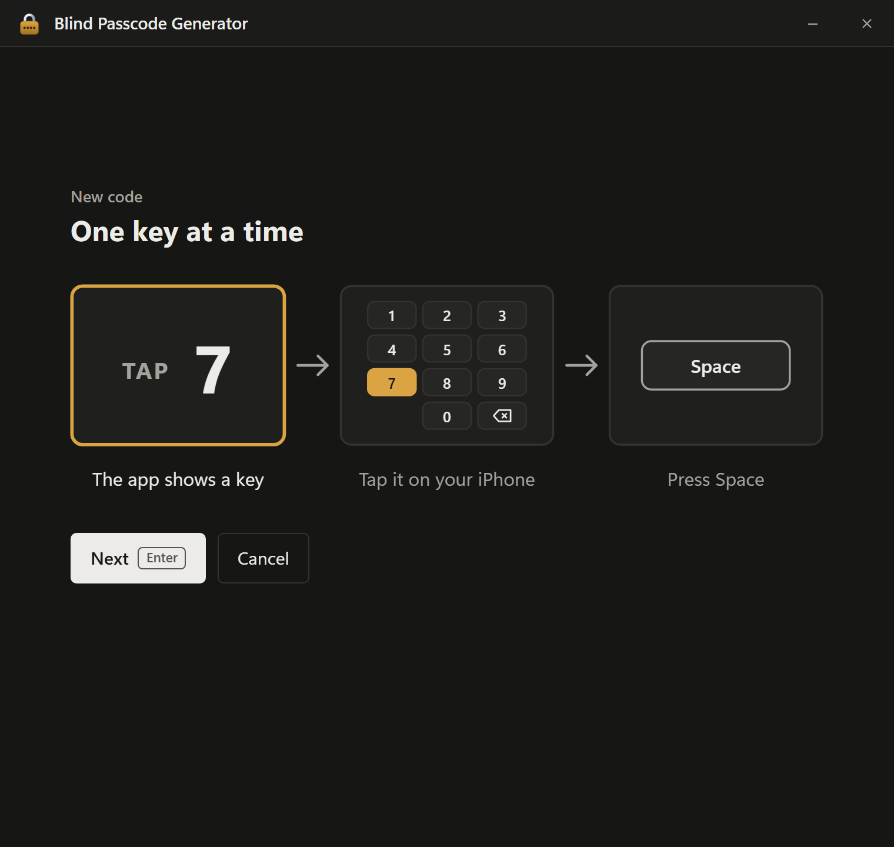
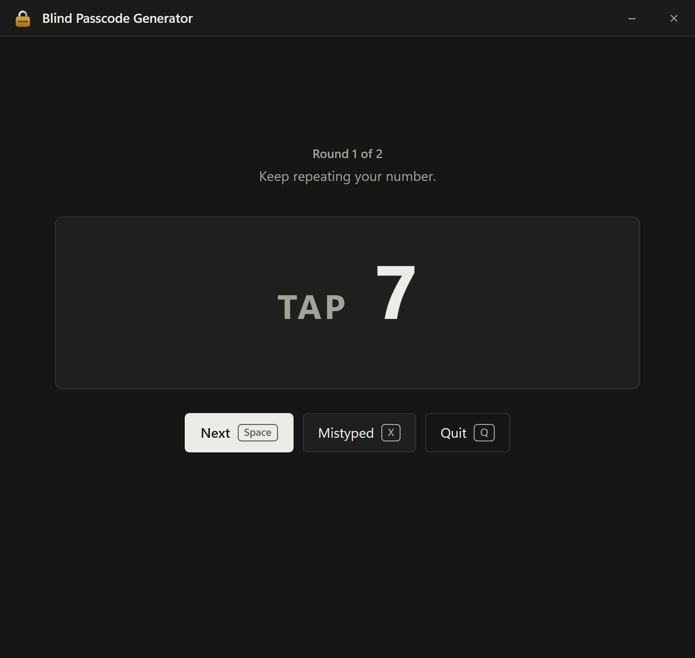

# Blind Passcode Generator

Set a passcode **that you yourself don't know**. Built for the **iPhone
Screen Time passcode**; works for any keypad code of 3-16 digits.

<p>
  
  
</p>

A Screen Time limit only holds if you can't switch it off. Blind Passcode
Generator picks the passcode and walks you through typing it without ever
showing it to you:

- It shows **one key at a time**, mixed with taps it then has you delete, so
  the keys you press don't spell out the code.
- You **cover the dots** on the phone and repeat a **memory number** in your
  head while you tap, which keeps the real digits from sticking.
- The code is saved behind a **time-lock**. Getting it back makes your
  computer work nonstop for as long as you chose: a minute, an hour, a day.

## Install

**Windows.** Download
[Blind-Passcode-Generator-setup-x64.exe](https://github.com/uncleyam/blind-passcode-generator/releases/latest/download/Blind-Passcode-Generator-setup-x64.exe)
and run it. Windows may say it protected your PC, because the installer isn't
signed yet: choose **More info**, then **Run anyway**.

**Linux**, on a 64-bit Intel or AMD computer. On Ubuntu 22.04, Debian 12, or
anything newer built on them:

```
wget https://github.com/uncleyam/blind-passcode-generator/releases/latest/download/Blind-Passcode-Generator-amd64.deb
sudo apt install ./Blind-Passcode-Generator-amd64.deb
```

Then open Blind Passcode Generator from your app menu. On other systems, use
the AppImage:

```
wget https://github.com/uncleyam/blind-passcode-generator/releases/latest/download/Blind-Passcode-Generator-x86_64.AppImage
chmod +x Blind-Passcode-Generator-x86_64.AppImage
./Blind-Passcode-Generator-x86_64.AppImage
```

If the AppImage won't start, your system may be missing FUSE: add
`--appimage-extract-and-run` to the last line.

**Mac.** Not available yet.

## Setting a code

You need the iPhone, the computer and a sticky note.

1. On the iPhone, open **Settings > Screen Time > Lock Screen Time Settings**
   (or **Change Screen Time Passcode**) and stop at the keypad.
2. In the app, choose **New code** and follow the screens. Each one shows a
   single key: tap it on the phone, then press Space.
3. When the phone asks for your Apple ID, enter it. It is your way back in if
   the saved code is ever lost.

## Getting a code back

Choose **Reveal** beside the code. Your computer then works through the
time-lock, for about as long as you set when you made the code, and shows the
code at the end. Cancelling loses the progress.

Deleted codes wait 30 days in **Recently deleted**, where they can be restored.

## If you're locked out

If the saved code is gone, reset the Screen Time passcode on the iPhone with
the Apple ID you entered during setup.

## Where codes are kept

In the `.locker` folder in your home folder, one small file per code. At the
end of a setup the app offers to put a copy in a synced folder such as
OneDrive, iCloud Drive or Dropbox; set `LOCKER_BACKUP_DIR` to choose the
folder yourself. Uninstalling the app leaves these files alone.

The app collects nothing and works with the internet off. Its own code makes
no connections. On Windows, the Microsoft part that draws the window sends
Microsoft its own diagnostic data: see [PRIVACY.md](PRIVACY.md).

## Extra: locking away your own text

This is off until you turn on **Lock text** in Settings, the cog on Home.

It is for anything that isn't a keypad code, such as the password to a site
you want to stay off. Choose **Lock text** on Home, type or paste up to 32
characters, and pick how long a reveal should take.

You have seen this text, so the lock only holds if no other copy is left:
clear your clipboard, your notes and any saved password. And unlike a Screen
Time passcode, there is no Apple ID to fall back on. If the file is lost, so
is the text.

## Building from source

You need [Rust](https://rustup.rs) and [Node.js](https://nodejs.org) 22. On
Linux, also install the libraries the app is built against:

```
sudo apt install libwebkit2gtk-4.1-dev build-essential curl wget file libxdo-dev libssl-dev libayatana-appindicator3-dev librsvg2-dev libdbus-1-dev
```

Then:

```
cd app
npm install
npx tauri build --no-bundle
```

The app is then at `target/release/blind-passcode-generator`
(`blind-passcode-generator.exe` on Windows). `cargo test` runs the core's
tests.

The project began as Locker, and the code and the `.locker` folder keep that
name.

```
crates/core/      sequence, time-lock, file format, storage, locked text
app/src-tauri/    the app's Rust side, a thin shell over the core
app/ui/           the app's screens, in HTML and TypeScript
app/store/        the Microsoft Store package and its listing
assets/           the icon and the pictures on this page
tests/fixtures/   files generated by the original Locker
```

## Making a release

1. Set the version in `Cargo.toml` and commit.
2. Push a tag of that version with a `v` in front, such as `v1.0.0`.
3. The Release workflow tests the core and builds the app on Windows, Linux
   and Mac. It attaches the downloads to a draft release. Try them, then
   publish the draft.

The same run leaves the Microsoft Store package on its page under Artifacts,
for uploading to Partner Center. What to type there is in
[app/store/listing.md](app/store/listing.md). The Mac download is only attached once the
Apple signing secrets are set; until then the run keeps an unsigned build
under Artifacts for testing.

---

Screen Time is a feature of Apple iOS. This project is independent
and not affiliated with or endorsed by Apple Inc.

All of the code in this repo was written by AI
([Claude Code](https://claude.com/claude-code)). The main design
decisions were made by a human.

MIT licensed ([LICENSE](LICENSE)).
